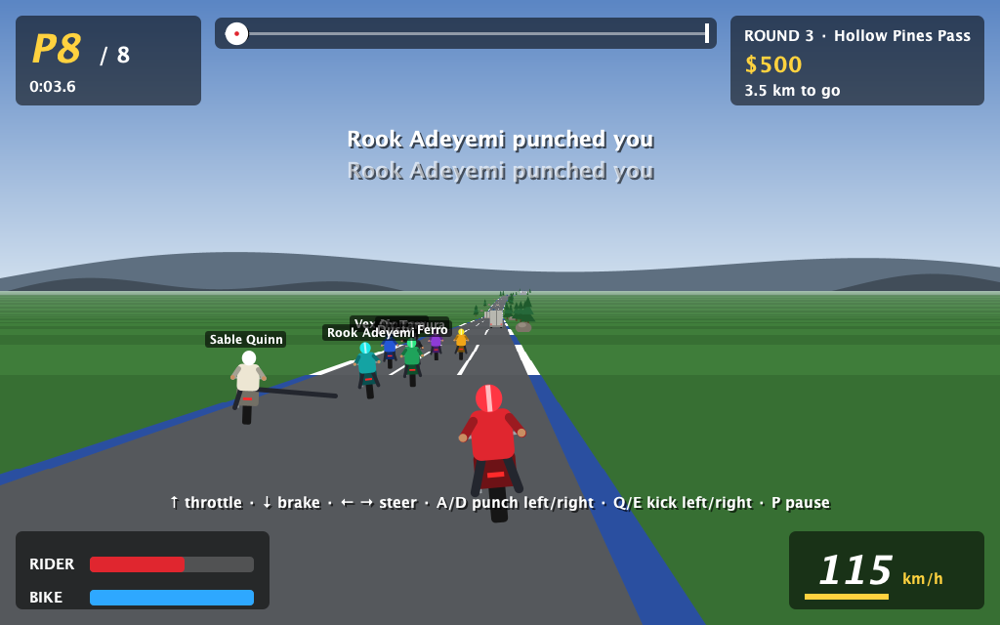
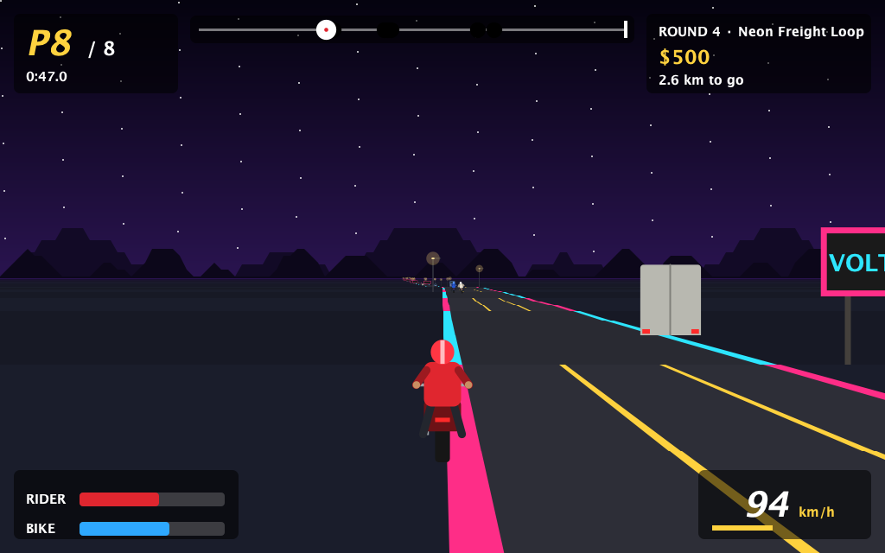

# Throttle Brawl

Highway racing with bare knuckles. Throttle Brawl is a pseudo-3D motorcycle combat racer
written in Java: punch and kick your way past seven rivals, dodge civilian traffic, and keep
your bike alive across a season of races.

The game is also a worked example of [JBCT](https://pragmatica.dev/java/jbct/course/)
(Java Backend Coding Technology) on [Pragmatica Core](https://central.sonatype.com/artifact/org.pragmatica-lite/core),
applied to something other than a backend: the whole race simulation is pure, immutable and
deterministic, and Swing sits at the edge as an adapter.




## Running

Requires **Java 25** and **Maven 3.9+**.

```bash
mvn package
java -jar target/throttle-brawl-1.0-SNAPSHOT.jar YourName
```

Or straight from source:

```bash
mvn compile exec:java -Dexec.args="YourName"
```

The rider name is optional (1–16 characters, defaults to `Rookie`).

## Controls

| Key         | Action                  |
|-------------|-------------------------|
| ↑           | Throttle                |
| ↓           | Brake                   |
| ← / →       | Steer                   |
| A / D       | Punch left / right      |
| Q / E       | Kick left / right       |
| P           | Pause                   |
| Enter       | Start / continue        |
| Esc         | Quit                    |

## How it plays

- **Ride.** Bends push you outward the faster you go; the grass caps your speed; trees,
  boulders, cacti, billboards and lamp posts end your ride on contact, and so do cars, vans
  and lorries.
- **Fight.** Punches are quick with short reach; kicks reach further and hurt more but
  recover slower. Blows land at mid-swing, cost the victim health and speed and shove them
  sideways. Empty a rider's health and they are knocked off.
- **Rivals.** Seven riders, each with their own pace, aggression and favorite lane. They
  swerve around traffic, hunt nearby riders, and hold a grudge against you.
- **Crash and recover.** Every crash damages your bike. You remount after a few seconds, but
  a bike at 0% is wrecked and your race is over.
- **Season.** Four tracks rotate (coast, desert, alpine, night city) and rivals get faster
  each round. Prize money depends on your finishing place; the workshop repairs as much as
  you can afford; a wrecked bike costs a towing fee. When the bike is too broken to race and
  the bank can't fix it, your career is over.

## Architecture

```
com.github.mostafaism1.throttlebrawl
├── ThrottleBrawl.java           entry point
├── domain/shared/               immutable value types shared by every use case
│   ├── Rider, Vehicle, Track, Strip, Prop, RaceState, Season, ...
│   ├── TrackCatalog, Roster     built-in courses and rival riders
│   ├── Melee                    who can be hit from where
│   ├── Noise                    stateless deterministic randomness
│   └── Tuning                   physics and gameplay constants
├── usecase/
│   ├── startrace/               StartRace   Season → Result<RaceState>
│   ├── advancerace/             AdvanceRace RaceState × Controls → RaceState
│   └── settlerace/              SettleRace  Season × RaceState → Report
└── adapter/swing/               window, keyboard, game loop, renderer, HUD
```

### Use cases

- **`StartRace`** validates the request (field size 1–7, bike condition at least 20%) and
  lines the player up at the back of the grid of the season's current track. Failures are
  typed `StartRaceError` causes, returned as `Result`.
- **`AdvanceRace`** advances one fixed 1/60 s tick. While racing, each tick is a sequencer
  of five steps:

  1. **Pilots**: the rivals decide how to steer and whether to attack.
  2. **Motion**: throttle, brakes, drag, steering, drift on bends, the grass penalty, swing timing.
  3. **Brawl**: blows reaching mid-swing land.
  4. **Contact**: collisions with traffic, scenery and other riders.
  5. **Stewards**: crashed riders are remounted or retired, finishes recorded, traffic recycled, the race closed.

  Each step is an injectable single-method interface, so any of them can be replaced in tests.
- **`SettleRace`** pays out the purse, charges towing, buys repairs, and moves the season
  to the next round.

### Design notes

- **Pure and deterministic.** Randomness comes from `Noise.sample(seed, tick, salt)`, a
  stateless hash, so the same seed and inputs always produce the same race (there is a
  test asserting exactly that).
- **Immutable state.** Every rule takes a `RaceState` and returns a new one.
  Mutable state lives only in `GameWindow`, confined to the Swing event thread.
- **Four return kinds.** Steps that cannot fail return plain values; absence is `Option`;
  validation is `Result`. There are no business exceptions and no nulls.
- **Rendering.** `RoadRenderer` projects 160 road strips ahead of the camera, accumulates
  curvature, and paints far-to-near together with the sprites standing on each strip, so
  hill crests correctly hide what lies behind them. All sprites are drawn procedurally in
  `SpriteArtist`; there are no image assets.

## Development

```bash
mvn test        # run the test suite
mvn verify      # tests + JBCT format and lint check (jbct-maven-plugin)
```

With the [jbct CLI](https://github.com/siy/jbct-cli) installed:

```bash
jbct format src/main/java src/test/java
jbct lint src/main/java
```

Tests live under `src/test/java` and cover race start-up validation, the per-tick rules
(acceleration, off-road limits, steering, punches and kicks, knockouts, traffic and scenery
crashes, remounting, wrecks, finishing, determinism) and season settlement.
